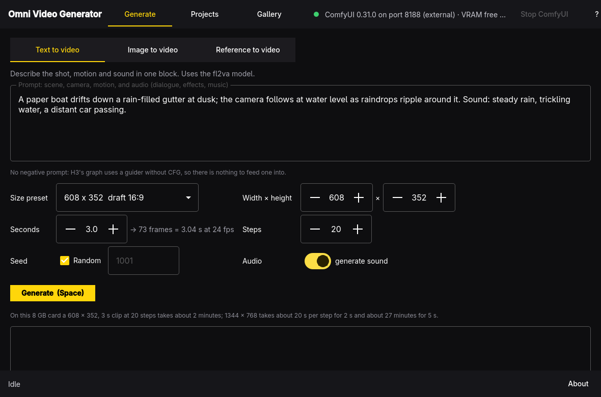

# Omni Video Generator



A desktop app for Omarchy (Arch Linux + Hyprland) that makes short videos with
sound from a text prompt, a start image, or reference images. It runs the
**MiniMax H3** open-weights video model on your own graphics card through a
local **ComfyUI** server. Nothing is sent to MiniMax or any other cloud
service.

- **ComfyUI**: a program that runs AI image and video models as a graph of
  steps ("nodes"). This app starts it, sends it jobs over its local HTTP API
  (the "API format" workflow JSON), and stops it again.
- **MiniMax H3**: a video model that generates picture and stereo sound
  together. Locally only H3-Base runs (about 768 px on the short edge, up to
  about 15 s); MiniMax's 2K upscaler and Context-IR are hosted services and
  are never called.

It is built the way Omarchy's own apps are: C++ and Qt Quick, qmake6, one
binary, follows the Omarchy theme, keyboard first, and every action also works
headless from the command line with `--json` output.

## Modes

| Mode | What you give it | ComfyUI node | Model file |
|---|---|---|---|
| `t2v` text to video | a prompt | `MiniMaxH3ImageToVideo` (no keyframes) | `minimax_h3_fl2va_pruned_int8_convrot.safetensors` |
| `i2v` image to video | a prompt and one image (the first frame, `<Picture 1>`) | `MiniMaxH3ImageToVideo` `first_frame` | same fl2va file |
| `r2v` reference to video | a prompt and up to 9 images named `<Picture 1>`...`<Picture 9>` | `MiniMaxH3ReferenceToVideo` | `minimax_h3_ref2va_pruned_int8_convrot.safetensors` |

All three share the text encoder `qwen3vl_32b_minimax_h3_nvfp4_awq.safetensors`,
the video VAE `minimax_h3_video_vae_fp16.safetensors` and the audio VAE
`minimax_h3_audio_vae_fp32.safetensors` (a VAE turns pictures or sound into
the model's compressed form and back). The sampler is `res_multistep`; the
scheduler is `simple` for t2v/i2v (ComfyUI's official templates) and `normal`
for r2v (the graph proven in earlier projects on this card).

The workflows live in `templates/t2v.json`, `i2v.json`, `r2v.json` as plain
ComfyUI API graphs with `{{placeholders}}`. The app reads them at run time, so
they can be edited without recompiling (copies are also compiled into the
binary as a fallback). `templates/r2v.json` is node-for-node the graph of the
proven `h3_api.py` script; a unit test checks this.

**Settings.** Width and height snap to multiples of 32. Seconds snap up to
H3's frame grid: the frame count is $n = \max(5, \operatorname{round}(24 s))$
raised to the next value of the form $17k + 5$ (5, 22, 39, 56, 73, ... frames),
at 24 frames per second. So 2 s gives 56 frames (2.33 s) and 3 s gives 73
frames (3.04 s). Steps default to 20 (quality drops noticeably below about 15).
The seed is random unless fixed. Audio can be switched off (the sound is still
generated inside the model, just not decoded or saved). There is **no negative
prompt**: H3's graph uses a guider without classifier-free guidance (CFG), so
there is nowhere to feed one.

## Measured on this machine

RTX 3070 with 8 GiB VRAM, 31 GiB RAM, ComfyUI 0.31.0, torch 2.13.0+cu130.
"VRAM peak" is the whole card from `nvidia-smi`, sampled every 2 s, and
includes about 1.4 GiB used by the desktop.

MEASUREMENTS_TABLE

## Projects (multi-shot videos)

A project is a folder `projects/NAME/` with a `shots.json`, like this:

```json
{
  "title": "Paper boat",
  "mode": "r2v",
  "width": 608, "height": 352, "steps": 20, "audio": true,
  "style": "Cinematic, natural light, no text, no subtitles, no watermark.",
  "refs": {"BOAT": "refs/boat.png"},
  "shots": [
    {"id": 1, "mode": "i2v", "image": "refs/boat.png", "seconds": 3, "seed": 1001,
     "prompt": "The scene opens exactly on <Picture 1>. The boat drifts and turns. Sound: rain."},
    {"id": 2, "refs": ["BOAT"], "seconds": 3,
     "prompt": "The paper boat from {BOAT} spins in a small whirlpool. Sound: rain, a hollow gurgle."}
  ]
}
```

- `{BOAT}` in a prompt becomes `<Picture i>`, where `i` is the position of
  `BOAT` in that shot's `refs` list. The `style` text is appended to every
  prompt. A shot without a seed gets `1000 + id`.
- `project render NAME` renders every shot that is missing or out of date,
  one GPU job at a time, with progress and a time estimate (ETA). Clips go to
  `clips/shot_NN_sSEED.mp4`; `state.json` records what was rendered with which
  settings.
- `project render NAME --shot 2 --new-seed` retries one shot with a new
  random seed (`--shot 2` alone re-renders it with the same seed).
- `project stitch NAME` joins the shots with hard cuts into
  `video_N.mp4` (N is one past the highest number already used, so nothing is
  ever overwritten), normalised to the project size, 24 fps, H.264 + AAC
  48 kHz stereo, and writes `video_N_manifest.json` with every prompt, seed,
  reference image, setting, model file name, frame count, start time in the
  final video, the ffmpeg command, the ComfyUI version and this app's git
  commit.
- `project contact NAME` makes contact sheets (start, middle and end frame of
  each shot side by side) in `contact/`, plus `contact/all.png` with every
  shot stacked, for a quick review.

## Command line

```
omni-video-generator open                       # the window (also: no arguments)
omni-video-generator comfy start|stop|status
omni-video-generator gen --mode t2v|i2v|r2v --prompt "..." [--ref IMG]...
      [--width 608 --height 352 --seconds 3 --seed N --steps 20] [--no-audio] [--json]
omni-video-generator project new|render|stitch|status|contact NAME
omni-video-generator project list
omni-video-generator gallery | contact FILE.mp4 | probe FILE.mp4
```

Each command exits 0 on success and 1 on failure with the reason on stderr.
`--json` prints one JSON object; `--progress-json` streams one JSON event per
line (the window drives jobs this way). Single generations go to
`output/gen/` with a `.json` sidecar holding the full workflow and settings.

## Sharing the GPU

Another app on this machine (omni_upscaler) uses the same card. Every GPU job
takes an exclusive lock on `$XDG_RUNTIME_DIR/omni-gpu.lock` (`flock`, the
same lock the shell command `flock` uses) and holds it from before the model
loads until it is unloaded again. While another app holds it, the job waits
and says "waiting for GPU (in use by another app)". When a job ends the app
asks ComfyUI to unload the models (`/free`), and if this job started ComfyUI,
stops it. The window stops a ComfyUI it started after 10 idle minutes.

## Where things live

Everything is inside `~/omni_video_generator` (or `$OMNI_VIDEO_HOME`):

| Path | What | In git? |
|---|---|---|
| `comfyui/` | ComfyUI 0.31.0 code and the H3 model files (~60 GB) | no |
| `.venv/` | Python 3.14.6 environment for ComfyUI, built by `scripts/setup_venv.sh` with `uv` | no |
| `.cache/`, `.tmp/`, `.comfy-user/` | caches, logs, ComfyUI's settings and database | no |
| `input/`, `output/` | ComfyUI's input (uploaded images) and output folders | no |
| `projects/` | your projects | no |
| `templates/` | the editable workflow templates | yes |
| `env/comfyenv-requirements.txt` | exact Python package versions | yes |

ComfyUI is started with the flags proven on this card: `--listen 127.0.0.1`
(local only), `--reserve-vram 1.0` (leave 1 GB for the desktop),
`--disable-pinned-memory` (do not lock tens of GB of RAM), `--fast-disk`
(stream weights that do not fit from the NVMe disk), plus
`--disable-api-nodes` (no cloud nodes, no frontend internet access) and
in-project input, output, temp and user folders. The environment sets
`HF_HUB_OFFLINE=1`, so no model is ever downloaded at run time. If a model
file is missing the job stops and names it; the app never downloads weights.

## Keyboard

| Key | Action |
|---|---|
| `?` or `F1` | Show all shortcuts |
| `1` `2` `3` | Generate, Projects, Gallery |
| `Space` or `Ctrl+Enter` | Generate / render the project / play or pause |
| `Ctrl+.` | Cancel the running job |
| `C` | Start or stop ComfyUI |
| `R` | Projects: retry the selected shot with a new seed |
| `S` | Projects: stitch |
| `G` | Projects: contact sheets |
| `Left` `Right` | Gallery: seek 5 s |
| `A` | About and licence |
| `Esc` | Close overlays, leave a text field |
| `Q` or `Ctrl+Q` | Quit (asks while a job runs) |

## Build, test, install

```
bin/build        # qmake6 + make -> build/omni-video-generator
bin/test         # Qt Test unit tests, offscreen
bin/install      # makepkg -f, then pkexec pacman -U (password pop-up)
scripts/setup_venv.sh   # (re)build .venv with uv
```

## MiniMax H3 licence (read this)

This app's code is MIT-licensed. The **model weights** it runs are not part
of this repository and are under the **MiniMax H3 Community License
Agreement** (dated 2 August 2026):
<https://huggingface.co/MiniMaxAI/MiniMax-H3/blob/main/LICENSE>. Key points,
summarised (not legal advice; the licence text is what counts):

- **Territory.** The licence only applies in the "Applicable Territory":
  worldwide **except the United States, the European Union, the United
  Kingdom and South Korea** (Sections I.3, I.5, II). Using the weights *or
  their outputs* outside that territory is not authorised (V.4, Acceptable
  Use Policy item 1); people there must ask MiniMax for a separate licence.
- **Commercial use** is allowed without a fee, but a product or service with
  more than **US$20 million** yearly revenue needs MiniMax's prior written
  authorisation (IV.1), and a commercial product must **prominently display
  "MiniMax H3"** in its interface (IV.2).
- **Redistribution** of the weights must include the licence and a NOTICE
  file; modified files must say they were modified (III).
- **Outputs**: MiniMax claims no rights over what you generate, and you are
  fully responsible for it (VI.4). You may not use outputs to improve other AI
  models (V.3). Publicly posted machine-generated content must be clearly
  disclosed as such (AUP item 12); the app tags stitched videos with an
  "AI-generated with MiniMax H3" metadata comment.
- **Acceptable Use Policy** (Exhibit A) forbids, among others, impersonating
  people without consent, harassment and defamation, election or harmful
  disinformation, content that harms minors, military use, and high-risk
  automated decisions.
- **Patent/IP suits** against MiniMax over the model end your licence (VI.3).
  Governing law: Hong Kong (IX).
- The text encoder is based on Qwen3-VL-32B (Apache 2.0).

## Licence

MIT for this app (see `LICENSE`); see `NOTICE` for the third-party parts it
drives. ComfyUI (GPL-3.0) is not included in this repository.
